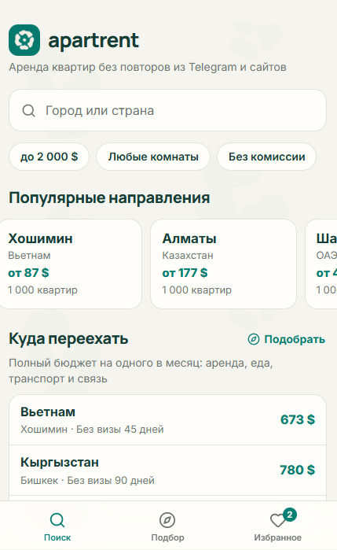
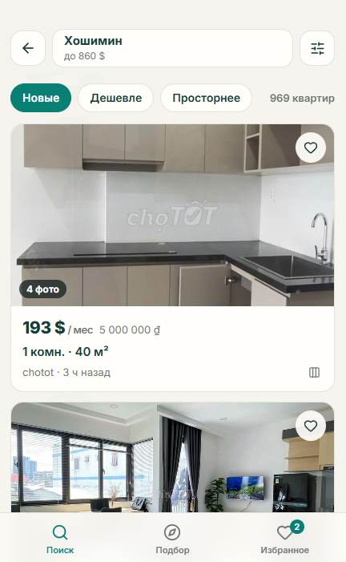
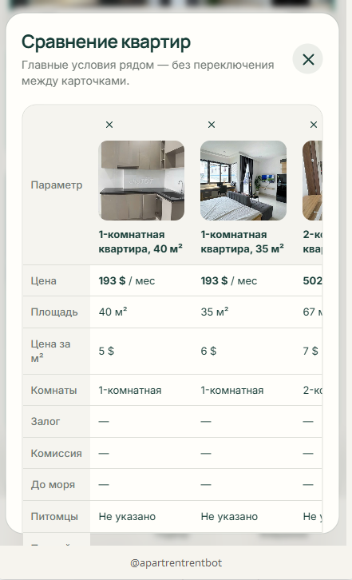
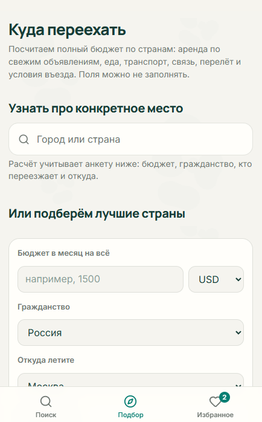

# Apartrent

Поиск квартир в долгосрочную аренду по 40 странам в одном месте. Apartrent собирает объявления из Telegram-каналов и сайтов недвижимости, убирает повторы и показывает цены в вашей валюте. Работает как мини-приложение внутри Telegram.

**Открыть:** [t.me/apartrentrentbot](https://t.me/apartrentrentbot) · **Канал:** [t.me/apartrentrent](https://t.me/apartrentrent)

> Это публичная страница проекта: описание, история изменений и обратная связь. Исходный код закрыт.

  
  
  
  

## Цифры

| Активных объявлений | Городов | Стран | Обновление |
| --- | --- | --- | --- |
| ≈105 000 | ≈630 | 40 | каждые 15 минут |

Источники: около 250 Telegram-каналов и несколько сотен страниц сайтов недвижимости. Данные на 13 октября 2026.

## Что умеет

- **Поиск по городу или стране** с подсказками и популярными направлениями.
- **Фильтры**: бюджет, комнаты, площадь, «без комиссии». Сортировка по новизне, цене, площади.
- **Цены в вашей валюте** по актуальному курсу, оригинальная цена рядом.
- **Без дублей**: одно объявление из разных каналов и сайтов показывается один раз.
- **Сравнение с рынком**: видно, дешевле или дороже квартира похожих в этом городе. На главной — подборка «Дешевле, чем обычно».
- **Сравнение квартир** таблицей: цена, площадь, цена за м², залог, комиссия.
- **Избранное** в облаке Telegram, доступно с любого устройства.
- **«Куда переехать»**: месячный бюджет по странам (аренда, еда, транспорт, связь, перелёт) и условия въезда с учётом гражданства и состава семьи.
- **Проверка объявления**: что известно из публикации, что стоит уточнить, предупреждения вроде просьбы оплатить до просмотра.

## Покрытие

**Много объявлений:** Россия, Турция, США, Польша, Испания, Румыния, Казахстан, Португалия, Вьетнам, ОАЭ, Малайзия.

**Мало объявлений:** Италия, Франция, Нидерланды, Ирландия, Марокко, Аргентина.

Нет вашего города или там пусто — [откройте issue](../../issues/new?template=city.md), подключим источники.

## Цена

Бесплатно, без рекламы и платных функций. Регистрация не нужна, вход по аккаунту Telegram. Для доступа к поиску нужна подписка на канал [@apartrentrent](https://t.me/apartrentrent).

## Как устроено

| Часть | Технологии |
| --- | --- |
| Сбор объявлений | Python 3.11, Telethon, httpx, BeautifulSoup |
| Разбор текста | Собственный парсер цены, валюты, комнат и площади на нескольких языках |
| Данные и API | PostgreSQL, FastAPI |
| Интерфейс | React, TypeScript, Tailwind, Telegram WebApp API |
| Хостинг интерфейса | Cloudflare Workers |

Подробнее: [docs/architecture.md](docs/architecture.md).

## Ограничения

- Только Telegram: отдельного сайта и приложений для iOS и Android нет.
- Квартиру и собственника никто не проверяет. Проверка объявления подсказывает, что уточнить, но не гарантирует честность автора.
- Стоимость перелёта в расчёте переезда — оценка, не реальные цены билетов.

## Обратная связь

- Ошибка в цене, площади или дубль — [issue «Ошибка в объявлении»](../../issues/new?template=listing-bug.md)
- Добавить город или Telegram-канал — [issue «Город или источник»](../../issues/new?template=city.md)
- Новости — [t.me/apartrentrent](https://t.me/apartrentrent)

История изменений: [CHANGELOG.md](CHANGELOG.md)
