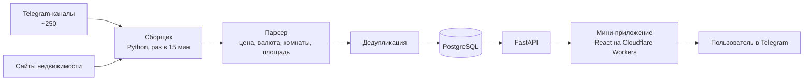

# Как устроен Apartrent

## Этапы

1. **Сбор.** Каждые 15 минут сборщик читает новые сообщения из Telegram-каналов (Telethon) и страницы сайтов недвижимости (httpx, BeautifulSoup).
2. **Разбор.** Объявления пишут в свободной форме на разных языках. Парсер извлекает цену и валюту, число комнат и площадь, тип аренды.
3. **Дедупликация.** Одно и то же объявление, опубликованное в нескольких местах, склеивается в одну карточку.
4. **Сравнение с рынком.** Для каждой квартиры считается, дешевле она или дороже похожих в том же городе.
5. **Выдача.** FastAPI отдаёт каталог мини-приложению. Первая страница открывается примерно за 0,4 секунды.

## Доступ и безопасность

- Вход по аккаунту Telegram. Подпись данных `initData` проверяется на сервере.
- Подписка на канал проверяется через Bot API.
- Избранное хранится в Telegram Cloud Storage пользователя.
